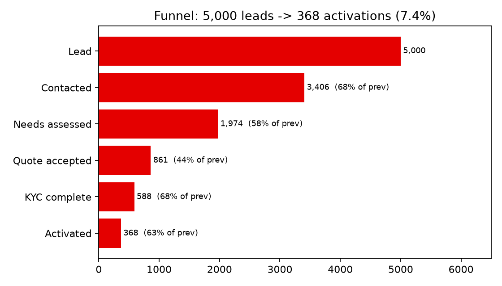
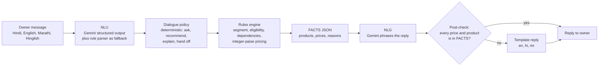
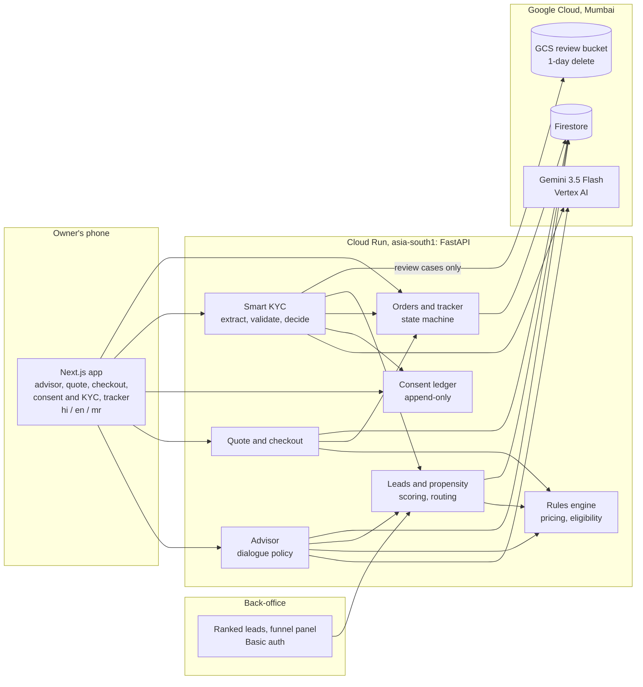
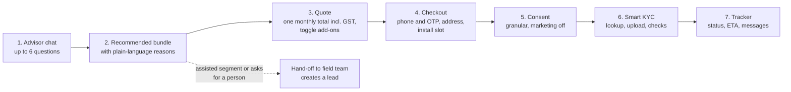
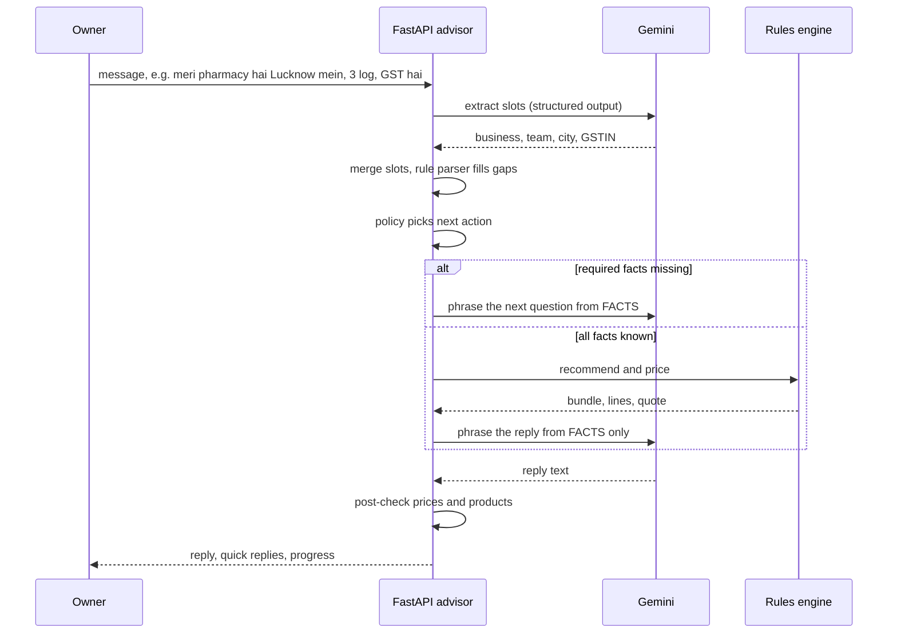
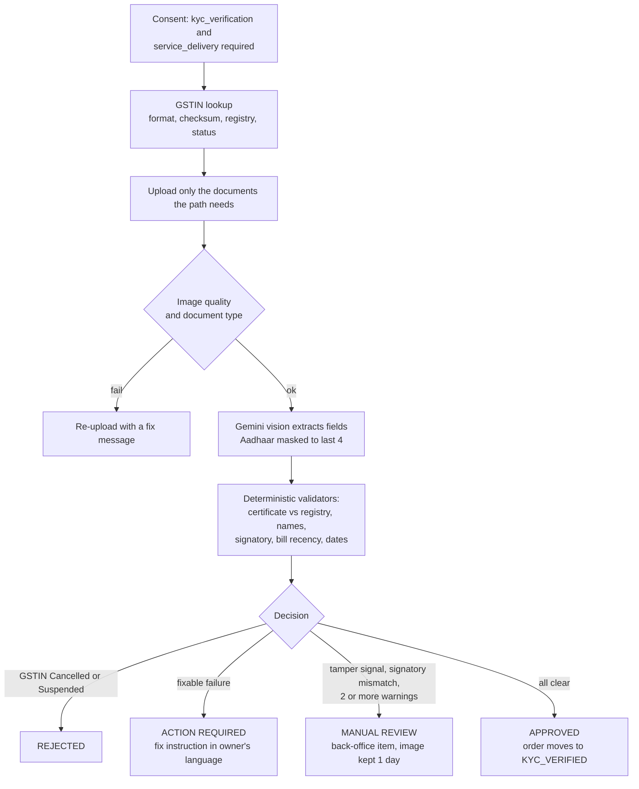
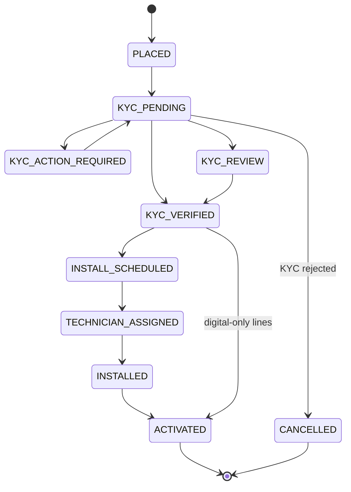
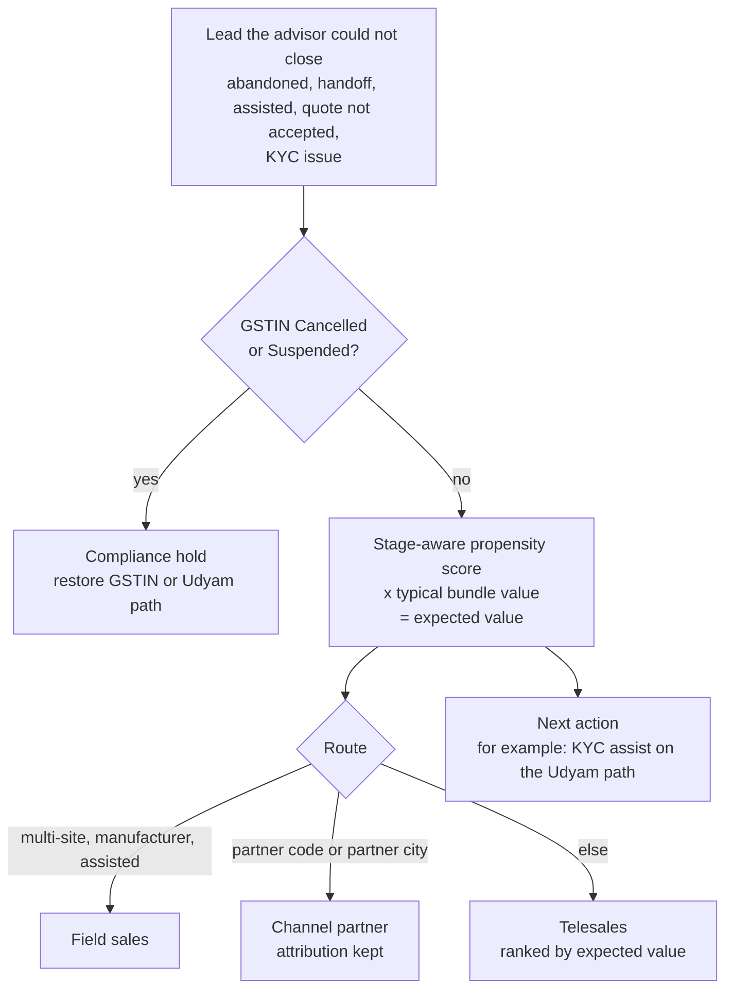
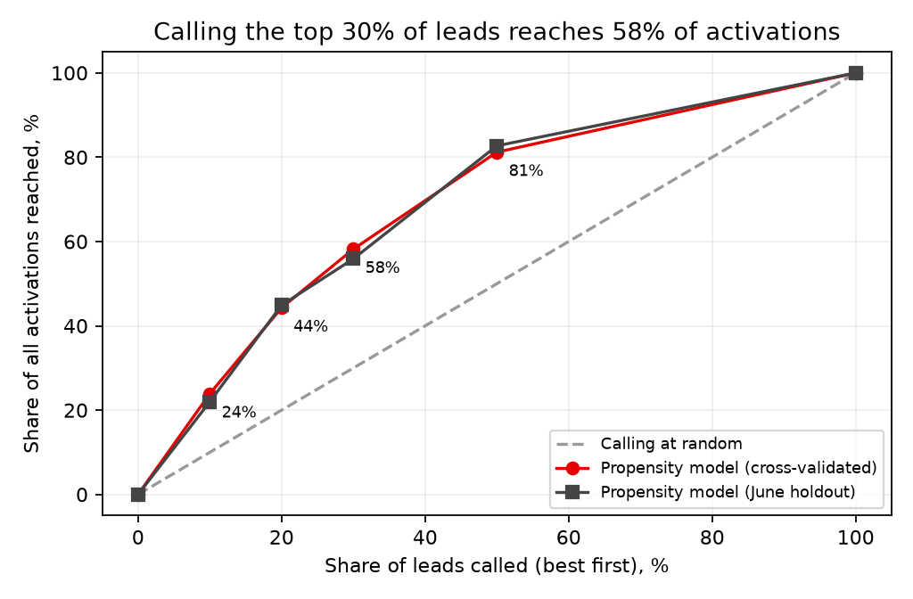

# Udyam Digital — Accel Business

**Airtel SYNC / YTL Hackathon 2026 · Enterprise Track A · "Project Udyam Digital"**

A small-business owner describes the business in Hindi, English or Marathi, gets a bundle recommended **from the real catalogue**, sees **one transparent monthly price**, passes a **smart KYC** check with a clear consent screen, and follows the order in a **tracker** instead of calling support. A back-office ranks the leads the advisor could not close.

> All data in this repo is **synthetic**. The app is branded as a fictional "Accel Business"; no Airtel branding is used.

**Live demo (Cloud Run, Mumbai):** [web](https://udyam-web-pgpuxkitcq-el.a.run.app/hi) · [API health](https://udyam-api-pgpuxkitcq-el.a.run.app/health) · back-office at `/backoffice` (credentials held by the team)



## The problem in numbers
5,000 leads became 368 activations (7.4%). The steepest drop is *needs assessed → quote accepted* (44%). It takes **17.6 days** from lead to activation, each customer makes **3 status calls**, and the blended cost per activation is **₹15,053** against a ₹6,900 median monthly bundle. Leads with a GSTIN activate at 9.6% versus 2.0% without. The data findings (11 planted signals and 4 null results) are in [`docs/findings.md`](docs/findings.md).

## One design rule
> **The LLM never decides price, eligibility or a KYC outcome.**
> It turns the owner's words into structured facts and phrases the reply. Deterministic, tested Python owns every business decision, and a code post-check rejects any reply that mentions a price or product that is not in the facts.



## What it does

| Challenge deliverable | Where |
|---|---|
| **D1 Advisor** (GenAI, recommends from the catalogue, explains why) | `api/app/advisor`, `/[locale]/advisor` |
| **D2 Quote and checkout** (one price, toggleable add-ons) | `api/app/engine`, `/[locale]/quote`, `/[locale]/checkout` |
| **D3 Smart KYC** (extraction, validation, mocked GSTIN and Udyam lookups, consent) | `api/app/kyc`, `api/app/consent`, `/[locale]/kyc` |
| **D4 Tracker** | `api/app/orders`, `/[locale]/track` |
| D5 Video script and repo | `docs/video_script.md` |
| D6 Architecture diagram | below, `docs/architecture.md` |
| D7 Business case (10 slides) | `docs/slides_outline.md` |
| D8 One-page privacy and security note | `docs/privacy_note.md` |
| S1 / S2 Back-office and propensity score | `/backoffice`, `api/app/leads`, `docs/model_card.md` |

## Architecture



Dashed "production path" items (real GSTN and Udyam APIs, DigiLocker and e-sign, WhatsApp Business, Pub/Sub into BigQuery, OSS/BSS, model operations) are on the full diagram in [`docs/architecture.md`](docs/architecture.md) and are **not built**.

## Owner journey



## Advisor turn (sequence)



## Smart KYC



The extraction model reads documents, but **every outcome comes from the validators**. Calibrated thresholds are in `docs/assumptions.md` (A10, A30–A37).

## Order state machine



Digital products (email, messaging, security licences) go live right after KYC; physical ones (broadband, SIMs, CCTV, POS) follow the install steps.

## Leads: scoring and routing



## Propensity model (ranking leads to call)

Logistic regression, one model per funnel stage reached, trained only on facts the advisor collects (no leakage). Full details: [`docs/model_card.md`](docs/model_card.md).

| Metric | Result |
|---|---|
| Cross-validated AUC (5x5 folds, tuned inside each fold) | 0.719 ± 0.026 |
| June time holdout AUC (95% CI) | 0.729 (0.690–0.767) |
| Train − validation gap | 0.019 |
| Calibration error (ECE) | 0.022 |
| Beats the first version | +0.031 AUC, better on 96% of paired folds |
| Calling the top 30% of leads reaches | **58% of activations** |



A score of about 0.72 AUC is modest, as expected for this noisy synthetic outcome. It is used to **rank whom to call first inside a queue**, not to forecast. Quality gates (CV AUC ≥ 0.70, overfit gap ≤ 0.04, ECE ≤ 0.03, shuffled-label check, gain chart, per-stage calibration) run in `api/tests/test_propensity.py`.

## Quality and evidence

| Check | Result |
|---|---|
| Offline tests (fake LLM) | **242 pass** |
| Advisor scenarios, live Gemini | **17/17**, also **17/17 against the deployed API** |
| Messy conversations (typos, Hinglish, Marathi, injection), live Gemini | **14/14** |
| KYC on 12 specimen applicants, live Gemini vision | **12/12** match the answer key (a **draft** written by the team; see status) |
| KYC on the deployed API | K03 approved, K11 action required, as expected |

## Run it locally (about 5 minutes, no cloud account needed)
Prerequisites: Python 3.12+ with `pip`, Node 22+, (optional) Docker.

```bash
# 1. API  (uv is the package manager)
pip install uv
cd api
python -m uv sync                      # installs deps, creates .venv
cp .env.example .env                   # defaults are fine for local
python -m uv run python ../scripts/train_propensity.py     # once, about 2.5 min (the model file is git-ignored)
LLM_PROVIDER=fake SEED_ON_START=true python -m uv run uvicorn app.main:app --reload --port 8000
#   LLM_PROVIDER=fake  = offline rule-based understanding + template replies (no credentials)
#   SEED_ON_START=true = demo leads for the back-office + 3 demo orders

# 2. Web (second terminal)
cd web
cp .env.local.example .env.local       # NEXT_PUBLIC_API_URL=http://localhost:8000
npm install
npm run dev                            # http://localhost:3000  (redirects to /en)
```

Open http://localhost:3000/hi (Hindi), `/en`, `/mr`. The checkout **OTP is `123456`**. Try the one-shot message *"meri pharmacy hai Lucknow mein, 3 log kaam karte hain, GST hai"*.

### Local demo logins (defaults; the deployed service uses different secrets)
| What | Value |
|---|---|
| Back-office `/backoffice` | `admin` / `change-me` |
| Admin endpoints (`X-Admin-Token`) | `change-me` |
| Tracker demo button | open `/en/track/<order>?demo=1` (build the web app with `NEXT_PUBLIC_DEMO_ADMIN_TOKEN=change-me`) |
| Seeded demo orders | phone last 4 digits `0001`, `0002`, `0003` |

Specimen KYC documents for 12 applicants are in `data/raw/kyc_documents`. Upload `K03_*.png` (approved) or `K11_*.png` (stale bill). Offline, extraction reads a transcription fixture, so only those specimen images are readable (`docs/assumptions.md` A34).

## Tests and evaluations
```bash
cd api
python -m uv run pytest -q                                        # 242 tests, offline
python -m uv run python ../scripts/run_scenarios.py               # 17 advisor scenarios (--provider gemini, --base-url <url>)
python -m uv run python ../scripts/eval_kyc.py                    # 12 KYC applicants vs docs/kyc_expected.csv
python -m uv run python ../scripts/eval_kyc_http.py --base-url <url> K03 K11   # KYC against a deployed API (creates test orders)
cd ../web && npm run lint && npm run build
```
Browser tests (Playwright, not a web dependency) are in `scripts/e2e_*.mjs`; setup notes are at the top of each file.

## Configuration (`api/.env.example`)
`APP_ENV`, `STORAGE` (`memory` | `firestore`), `LLM_PROVIDER` (`gemini` | `fake`), `GEMINI_MODEL`, `GCP_PROJECT`, `GCP_LOCATION`, `GOOGLE_API_KEY`, `GCS_REVIEW_BUCKET`, `BACKOFFICE_USER` / `BACKOFFICE_PASSWORD`, `ADMIN_TOKEN`, `CORS_ORIGINS`, `GST_RATE`, `DATA_DIR`. Extras: `SEED_ON_START`, `RATE_LIMIT_ENABLED`. With `APP_ENV=prod` the API refuses to start on default secrets.

## Live Gemini and deploy
Set `LLM_PROVIDER=gemini` with Vertex AI credentials (`gcloud auth application-default login`, `GCP_PROJECT`) or an AI Studio `GOOGLE_API_KEY`. Gemini output varies slightly between runs, so re-run the live suites before a demo. Deployment: `scripts/deploy_gcp.sh` (dry-run by default) and [`docs/deploy.md`](docs/deploy.md). The deployed API runs a single instance on purpose (KYC uploads wait in memory until evaluation; rate limits are per instance) and re-seeds the demo data when it restarts.

## Privacy and security in one paragraph
Consent comes first, is granular, and marketing is off by default; every grant or withdrawal is an append-only ledger entry with the notice version and language. Only the documents a path needs are collected, photos are processed in memory and discarded (manual-review images are deleted after 1 day), Aadhaar is masked to the last 4 digits at once, logs mask phones and IDs, and all storage and AI processing stay in the Mumbai region. Details: [`docs/privacy_note.md`](docs/privacy_note.md).

## Repository map
```
api/            FastAPI app (app/), tests, config/*.yaml (bundle templates, fulfilment, routing)
web/            Next.js app (locales en / hi / mr) + English-only /backoffice
data/raw/       synthetic dataset (read-only)    data/derived/  city tiers, i18n names, KYC fixture, model (generated)
scripts/        train / eval / scenarios / seed / deploy / e2e / charts
docs/           data_contract, assumptions (A1-A67), findings, model_card, architecture, privacy note, slides, video script, deploy
PLAN.md         implementation plan the build followed
```

## Honest status
**Built and tested:** everything in the deliverables table, deployed on Cloud Run with Firestore and Vertex AI in Mumbai.

**Not done or not verified:**
- `docs/kyc_expected.csv` is a draft answer key written by the team; a human must verify K02, K05, K07 and K10.
- Hindi and Marathi strings and product names have not been reviewed by a native speaker.
- The propensity model is trained on the old sales process. It should be retrained on advisor-era leads once about 300 journeys with 30 activations exist (engagement logging is in place; `GET /backoffice/engagement`).
- PAN + utility-bill KYC path is shown as "coming soon"; voice (stretch) is not built.
- Slides and video are an outline and a script only.

Every judgement call is listed in [`docs/assumptions.md`](docs/assumptions.md).
