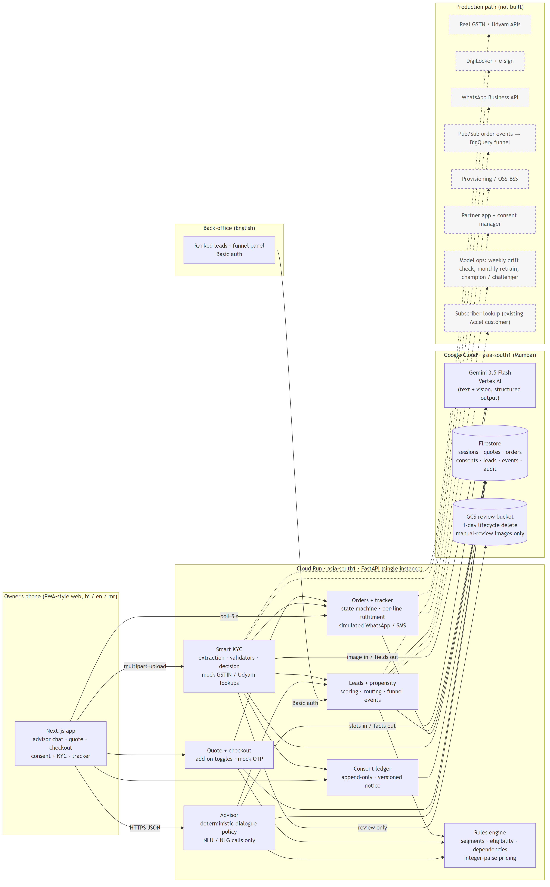

# Solution architecture

Source: [`architecture.mmd`](architecture.mmd) (Mermaid; re-export with `npx @mermaid-js/mermaid-cli -i docs/architecture.mmd -o docs/charts/architecture.png -s 2 -w 1800`).

## Components
| Component | Responsibility | Where |
|---|---|---|
| Web app | Mobile-first Next.js: landing, advisor chat, quote, checkout, consent + KYC, tracker; hi / en / mr. English-only back-office at `/backoffice`. | `web/` |
| Advisor | A **deterministic dialogue policy** decides the next step. The LLM only (a) turns the owner's words into structured slots and (b) phrases the reply from a facts JSON. A code post-check rejects any reply containing a price, percentage or product not in the facts and falls back to a template. If the LLM fails, a rule-based parser takes over. | `api/app/advisor`, `api/app/llm` |
| Rules engine | Segments, eligibility (city tier, size, GSTIN status), `requires_one_of` dependencies, bundle templates, pricing in **integer paise** (midpoint of the catalogue range, GST added). The LLM never touches price, eligibility or SKUs. | `api/app/engine`, `api/config/bundles.yaml` |
| Quote + checkout | Single monthly price incl. GST, toggleable add-ons (dependencies pulled in / removed with a message), mock OTP, frozen quote snapshot on the order. | `api/app/routers/quotes.py`, `checkout.py` |
| Consent ledger | Append-only grants / withdrawals, versioned notice, unbundled purposes, marketing off by default. KYC endpoints return 403 without `kyc_verification`. | `api/app/consent` |
| Smart KYC | Quality gate, vision extraction (one call per image, schema per document), validators (GSTIN checksum, registry status, certificate vs registry, name / address / signatory / bill recency), deterministic decision. Mock GSTIN and Udyam registries. | `api/app/kyc` |
| Orders + tracker | State machine, per-line fulfilment (digital lines live at once, physical lines follow install steps), ETAs, simulated WhatsApp / SMS in the owner's language. | `api/app/orders` |
| Leads + propensity | Leads the advisor could not close, scored by a logistic-regression propensity model (v2: only inputs the advisor collects, quality-gated in tests; [`model_card.md`](model_card.md)), ranked by expected monthly value, routed (field force / partner / telesales; Cancelled / Suspended GSTIN -> compliance hold), funnel panel from the event log. | `api/app/leads`, `api/app/analytics` |
| Storage | Firestore (Native, Mumbai) or in-memory for local / tests, behind one repository interface. Manual-review images only go to a GCS bucket with a 1-day lifecycle delete. | `api/app/repo` |

## Data flows (numbered as on the diagram)
1. **Advise:** phone -> Advisor -> (LLM: slots) -> engine -> quote -> (LLM: wording, post-checked) -> phone.
2. **Buy:** phone -> Quote (toggle add-ons) -> Checkout -> order created with a frozen quote.
3. **Verify:** phone -> consent -> KYC (lookup first, upload only what the path needs) -> extraction -> validators -> decision -> order state; manual review copies the images to the review bucket and creates a lead.
4. **Track:** phone polls the order; every transition appends an event and a simulated notification.
5. **Sell:** unclosed journeys become leads; scoring + routing feed the back-office; funnel events feed the KPI panel.

## Production path (dashed boxes, not built)
Real GSTN / Udyam APIs, DigiLocker + e-sign, WhatsApp Business API, Pub/Sub order events into BigQuery for funnel analytics, provisioning / OSS-BSS integration, partner app, consent-manager integration, model operations (weekly input-drift check, monthly time-split retrain, champion / challenger promotion), subscriber lookup for the "existing Accel customer" signal.
